# Monad

Monad is a terminal for macOS where every tab is a shell inside a virtual machine. It looks and behaves like Terminal.app, but the shell on the other side runs in a VM on Apple's [Virtualization framework](https://developer.apple.com/documentation/virtualization), isolated from your Mac by default. The VMs can be Linux or macOS.

It's meant for code you don't fully trust: coding agents, install scripts, samples, whatever. Opening a new tab is enough, the VM boots in a few seconds, and when you are done you close it. VM management is there when you need it and out of the way when you don't.

Everything is written from scratch: the terminal emulator, the network stack, the image decoders (qcow2, xz, tar), the OpenPGP verifier. The only things used from outside are Apple's frameworks, libSystem, zlib and the system `ssh`.

## Why

I've been doing everything inside VMs, especially with [Lima](https://lima-vm.io). It got to the point where I had a bunch of SSH forwards and shell scripts tying the VMs to services on my Mac, and my Mac and VM workflows still felt disconnected. It was worst when I wanted to run an LLM on my MacBook and use it from an agent inside a VM, or when I wanted to give that agent access to Xcode to build helper tooling on my Mac from inside the VM, without SSH and [socat](http://www.dest-unreach.org/socat/) shenanigans. Monad was built on that idea, and it solved all of those problems in my coding and reverse engineering work.

Also, with the huge wave of supply chain attacks, I wanted to avoid running code on my Mac while still trying out new technologies. Monad has helped me with all of that for months. Now it's time to share it with the world.

## Install

You need macOS 14 or later on Apple silicon. The VMs run arm64 Linux natively.

```sh
curl -fsSL https://raw.githubusercontent.com/buzzer-re/Monad/main/scripts/install.sh | sh
```

Monad is signed ad hoc (no Apple Developer ID), so macOS will refuse to open a copy downloaded with a browser. The install script downloads the latest release, checks it and puts it in `/Applications`. Before it removes macOS's quarantine flag it checks that the download matches the SHA-256 published with the release, that the app is Monad's release build and that its signature still holds. It never uses sudo, and it won't replace Monad while Monad or its VMs are running. What those checks don't prove is who built the release: the hash comes from the same release as the zip, and Monad is not notarized. If that matters to you, build it yourself with `--build`. (`MONAD_GITHUB=owner/repo` points the script at a fork.)

From a checkout you can install your own build instead:

```sh
scripts/install.sh --build                       # build the Release configuration into build/, then install
scripts/install.sh --release v1.0                # a given release
scripts/install.sh --from ~/Downloads/Monad.zip  # a zip or Monad.app you already have
```

A few things come with ad hoc signing. Each update looks like a new app to macOS, so it asks again for access to your folders and the local network, and firewalls like [LuLu](https://objective-see.org/products/lulu.html) ask again too. Without a team ID, MonadHost recognizes Monad by the exact code of the Monad.app installed beside it, so keep Monad in `/Applications`. [docs/SECURITY.md](docs/SECURITY.md) has the details.

## Every tab is a virtual machine

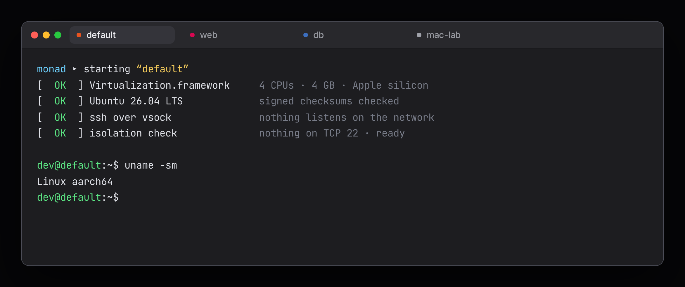

The first tab creates a VM called `default` from the Ubuntu cloud image. The terminal reaches the guest through ssh over virtio-vsock, and sshd never listens on any network. At each boot Monad checks that nothing listens on TCP port 22 before it opens a shell, and if something does, the VM is powered off.

## Linux VMs

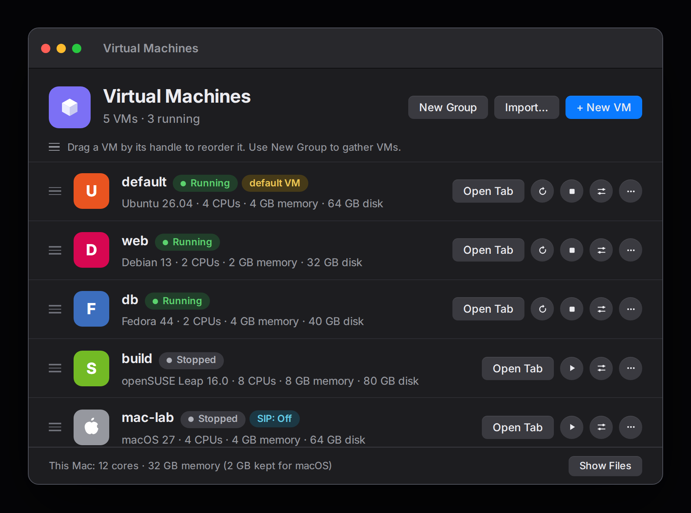

Monad comes with Ubuntu (26.04, 24.04), Debian (13, 12), Fedora 44 and openSUSE Leap 16.0. An image is downloaded once, checked against the distribution's signed checksums, converted to a raw disk and cached. Each VM gets an APFS clone of it, so a new VM costs almost no disk. cloud-init sets up the user, an ssh key made for that VM, and Monad's own pieces.

The VMs run in MonadHost, a launchd agent, so they keep running when you quit the app. Adding another distribution is pasting the link to its cloud image ([Distributions](#distributions)).

## Ephemeral VMs

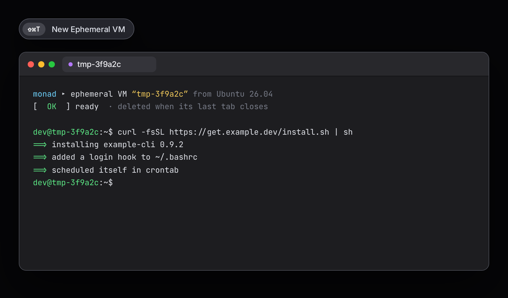

⇧⌘T opens an ephemeral VM, for code that should run once and leave nothing behind, like an install script or a repository you just cloned. Close its last tab and Monad deletes the VM and its disk.

## Profiles

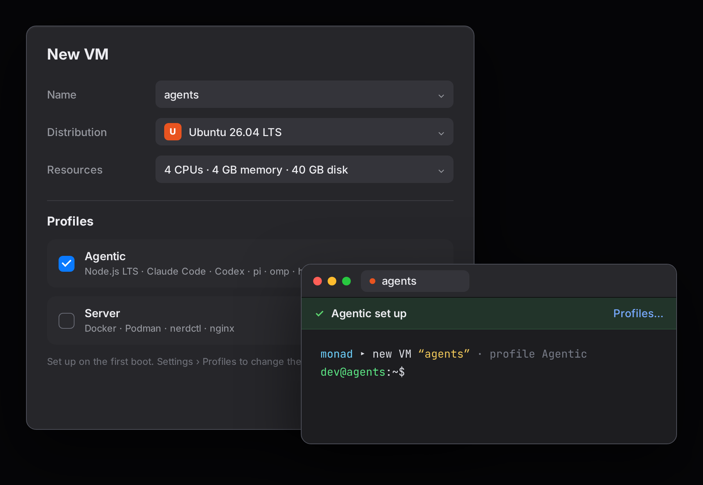

Tick a profile in New VM and the VM is set up on its first boot. Agentic brings [Claude Code](https://claude.com/product/claude-code), [Codex](https://github.com/openai/codex) and friends, with [herdr](https://herdr.dev) to keep them running, and Server brings container tooling. Profiles are files, so you can write your own.

## Splits and contexts

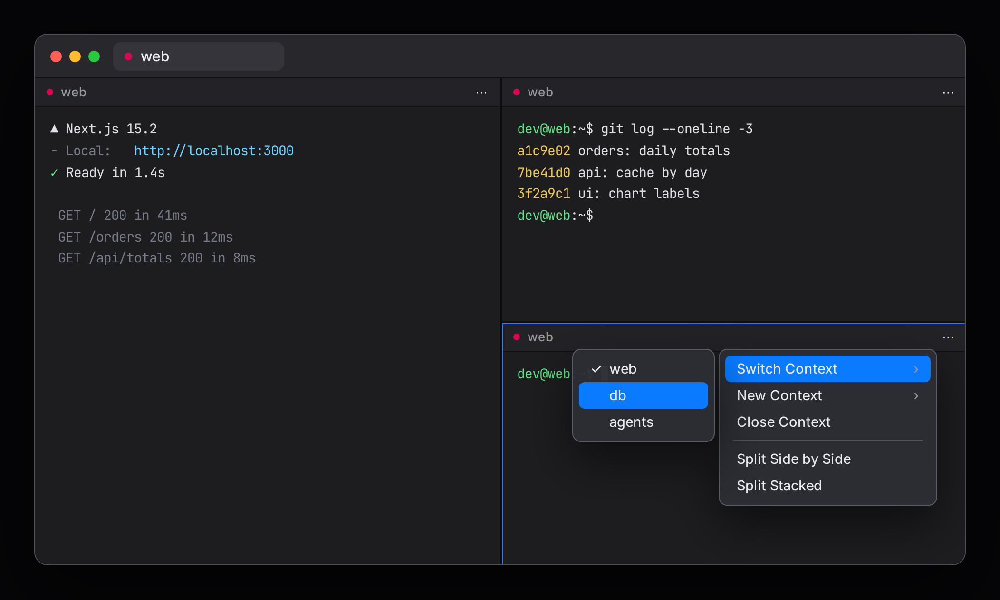

⇧⌘V and ⇧⌘H split a tab side by side or stacked. A pane holds several contexts, a VM session each, so one window can watch a web server, its repository and its database. Switch a pane's context from its menu, and drag a pane by its header to move it. Each VM also gets its own tab group, and the "…" in a tab opens tabs on other VMs.

## Ports forward themselves

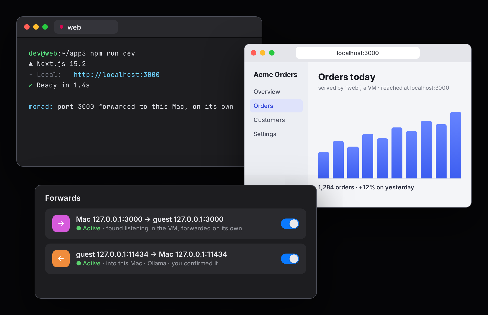

A small agent in the guest (a POSIX shell script) watches which ports the VM opens and tells Monad, so ports from 1024 up show on your Mac's localhost by themselves. Forwards go the other way too, unix sockets included, and you can open a SOCKS proxy into the VM. Here the VM uses [Ollama](https://ollama.com) on the Mac through a forward you confirmed.

## Shared folders

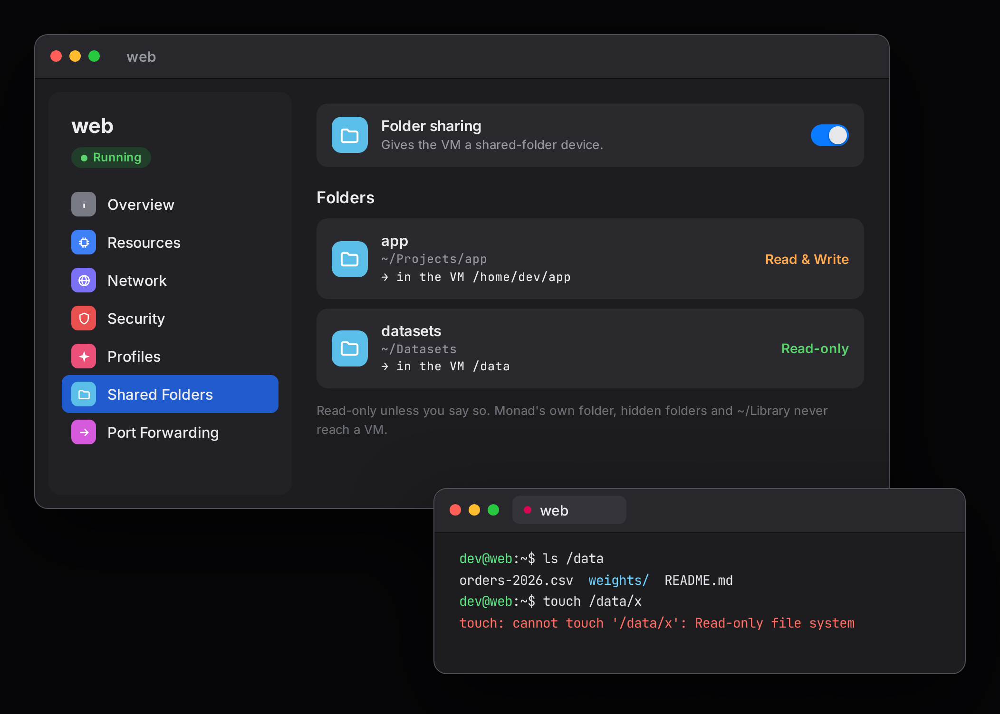

Mac folders are shared over virtio-fs and are read-only unless you say so. Monad's own folder, hidden folders and `~/Library` never reach a VM.

## Network and firewall

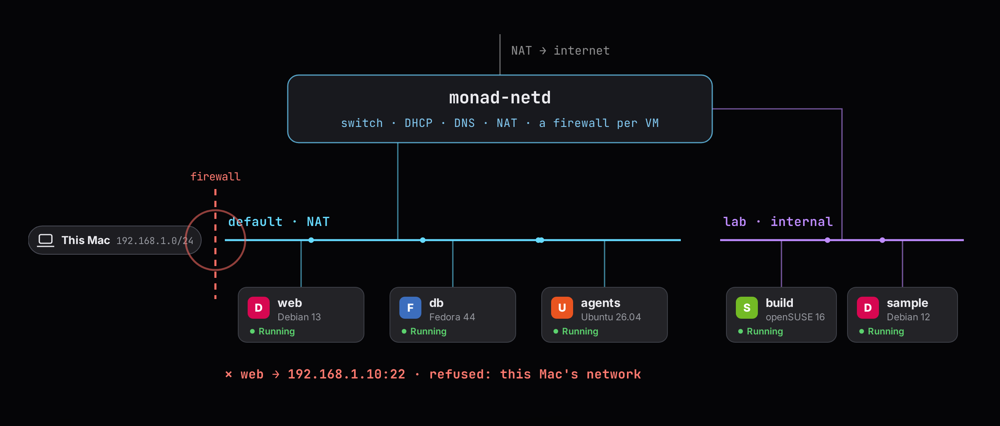

Networking goes through Monad's own stack, `monad-netd`, a sandboxed process that switches every VM's Ethernet frames. By default a VM reaches the internet and nothing else: not your Mac, not your LAN, and not the other VMs. Internal networks connect VMs to each other without the internet.

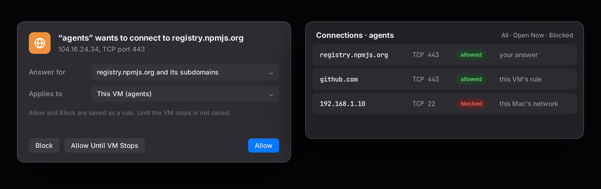

Per network you can pick an allowlist firewall, or monitor mode, where each new destination asks you first. Every connection a VM made is listed, and you can allow or block it from there.

## macOS VMs

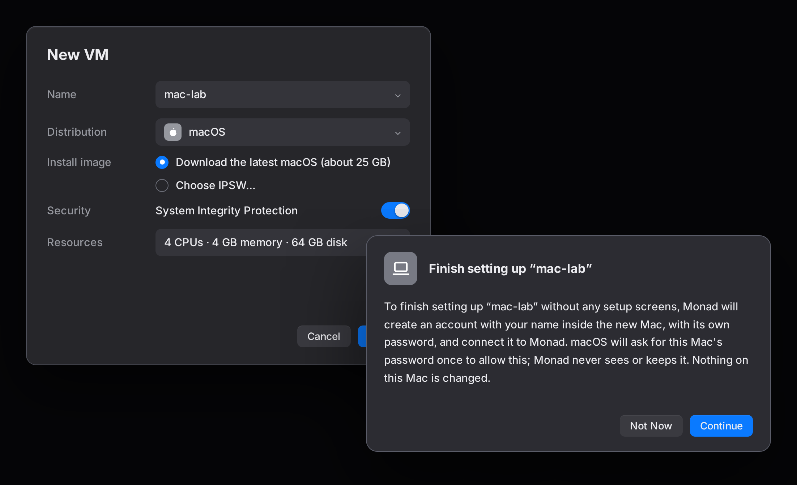

A VM can be a Mac too. Pick macOS in New VM, and Monad downloads the latest macOS your Mac can run from Apple (about 25 GB, once) or uses an IPSW you already have. There are no setup screens: macOS asks for your password once, so Monad can create the VM's account and its own pieces on the new disk, and after that the tab opens zsh like any other VM. Shared folders, forwards, the firewall and the MCP tools work the same.

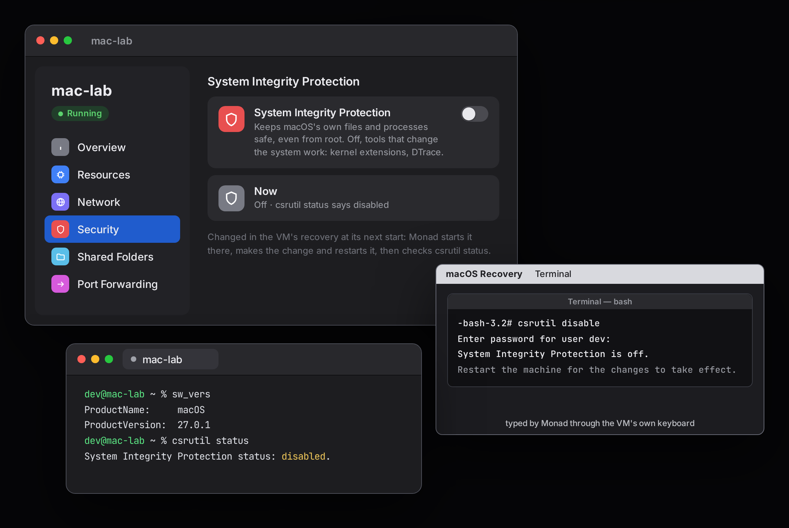

The Security page has the things only a Mac has. System Integrity Protection can be turned off: Monad boots the VM into recovery and types `csrutil disable` for you, then checks `csrutil status` when it's back. Full disk access for Monad's sessions is on by default, so `~/Documents` and the like work over ssh.

For what needs a person (the developer tools installer, a system prompt), ⋯ › Open macOS Desktop shows the VM's screen. Duplicate… (or the `clone_vm` tool) copies a stopped macOS VM in a moment, since the disk is an APFS clone, and the copy has its own identity. Apple allows two macOS VMs running at once on a Mac; a third is refused, and Monad tells you which ones to stop. [docs/MACOS.md](docs/MACOS.md) has how they work.

## The canvas

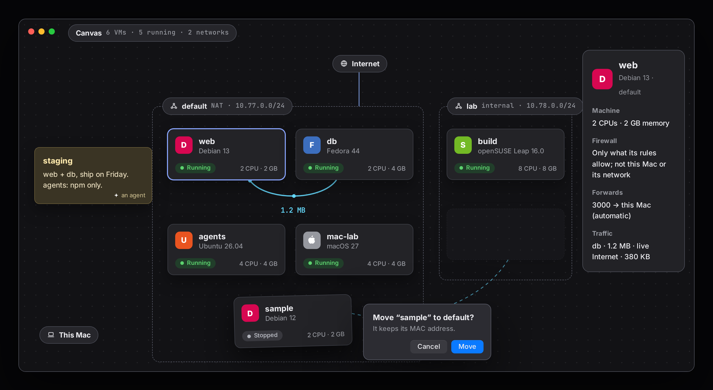

The Canvas (⇧⌘K) shows your networks as frames with their VMs inside. Drag a VM to another network to move it, and open a terminal on it right there. You can write on it too: notes, labels on VMs and networks, zones around them, arrows and freehand drawing. Agents write there through the MCP server, so when one builds you a lab, you watch it appear with the notes on what is what.

## Agents and MCP

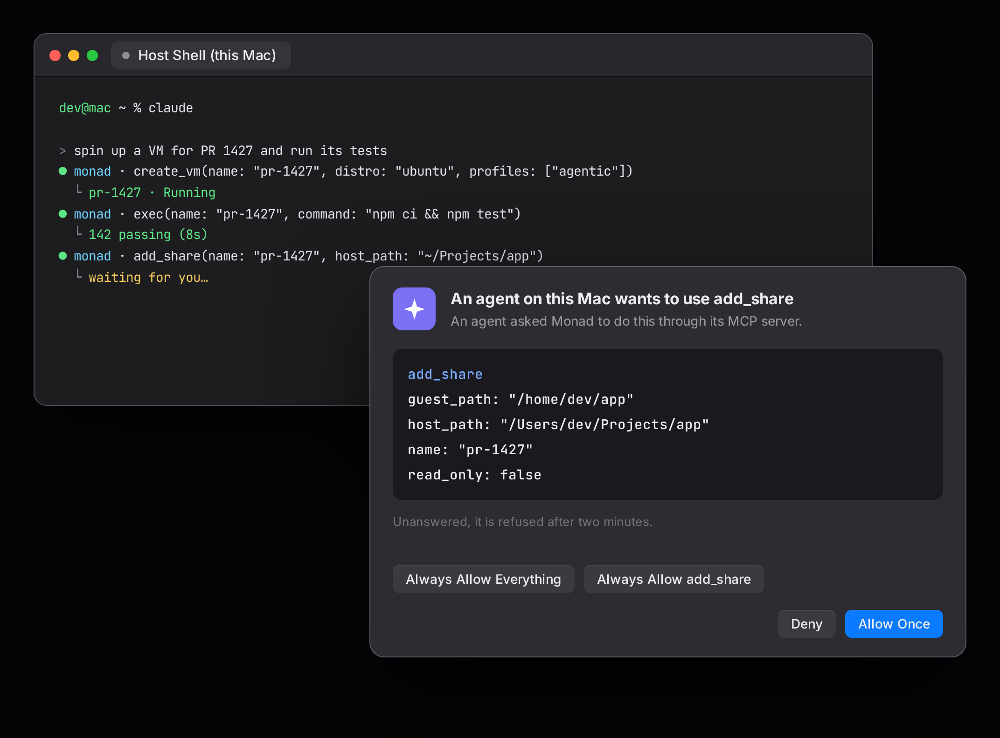

Monad has its own [MCP](https://modelcontextprotocol.io) server, so Claude Code, Codex or any agent that speaks MCP can drive it: create and start VMs, run commands in them, add a distro, open a forward. On the Mac you add it with one line (Settings › Agents has it ready to copy):

```sh
claude mcp add monad -- /Applications/Monad.app/Contents/MacOS/MonadHost --mcp
```

Anything that reaches into the Mac or can't be undone (a share, a bridge, deleting a VM) asks you first, and you can say "always" for one tool or for all of them.

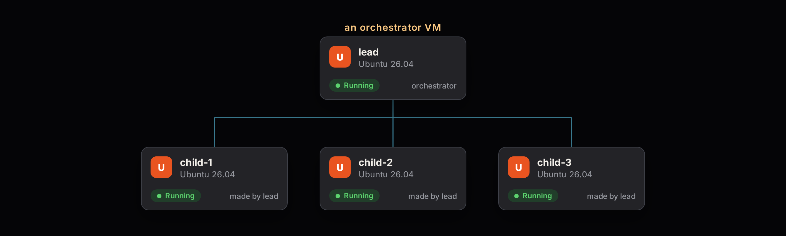

The server can also go inside a VM. Settings › Agents › Add to VM… gives a VM a role. As an orchestrator, it can create and run VMs of its own (within the limits you set) and asks you for everything else. Monad registers itself with Claude Code and Codex inside the VM, so they find it at the first prompt. [docs/AGENTS.md](docs/AGENTS.md) has the details.

## Bridges and host commands

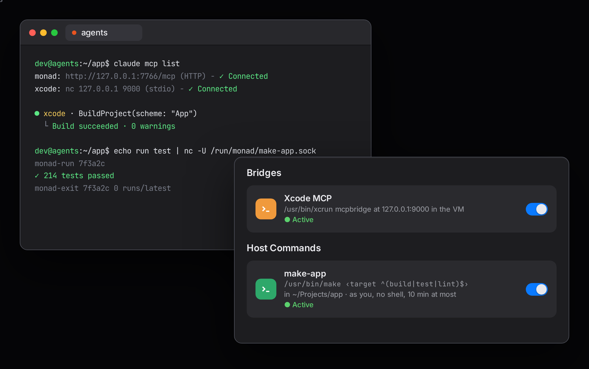

A bridge runs a Mac command for each connection to a port or socket inside the VM. I use it for `xcrun mcpbridge`, so an agent in a VM can drive Xcode on the Mac. The Mac side is a private socket rather than a network port.

Host commands give a VM's agents the Mac commands you defined for it as tools: a program, a folder it shares, and a pattern for every value the VM may pass, so `make test` on the Mac is fine but `make clean` or anything after a `;` never runs.

## Also in Monad

- Paste an image or drop files into a tab and they are copied into the VM (`~/.monad/shots/` and `~/.monad/uploads/`), with the path typed at the prompt. That's how coding agents like Claude Code take screenshots.
- Once you have more than a handful of VMs, put them in groups, like VirtualBox does: "coding", "analysis", "agents". A group also works as a firewall tag, so a rule you give the group applies to every VM in it ([docs/GROUPS.md](docs/GROUPS.md)).
- Themes work like Terminal.app's, all of its built-in ones included, with blur, transparency and background images. Images printed in the terminal (fastfetch, imgcat, chafa) are off by default and turned on per VM, since it's the guest choosing what gets decoded on your Mac.
- A VM's settings can be read and edited as JSON, exported as a backup, or imported to make a new VM ([docs/CONFIG.md](docs/CONFIG.md)).
- Monad finds your Lima VMs (the `vz` ones) and boots their disks in place, so the same VM works in Lima and in Monad (not both at once). "Copy to Monad" makes it Monad's own.

## Keys

| Keys | What |
|---|---|
| ⌘T | New tab on the VM in front (the default VM otherwise, which you pick with Make Default) |
| ⌘N | New window |
| ⇧⌘T | New ephemeral VM: deleted when its last tab closes |
| ⌥⌘N | Host shell (no VM, for when you need the Mac itself) |
| ⇧⌘V / ⇧⌘H | Split side by side / stacked |
| ⇧⌘M | Virtual Machines window |
| ⇧⌘K | Canvas |
| ⌥⌘, | Settings of the VM in front |
| ⇧⌘R | Restart the VM in front |
| ⌘K | Clear scrollback |

## Distributions

Adding a distribution is like adding a disk image in VMware or VirtualBox: in Settings › Distributions › New Distribution…, paste the link to the cloud image (or pick a file on your Mac), compressed or not. Monad looks next to the image for its checksum file and signature, and you can paste the project's key if you want the signature checked too. The Advanced switch shows everything else. Or write the JSON file yourself and drop it in `~/.monad/distros/`. A signature and https are recommended, not required: for a mirror on your own network, or an image without checksums, that's your call.

When a new distro doesn't boot, the guest says why on its console, which the boot tab shows. Look for the lines starting with `MONAD|`. [docs/DISTROS.md](docs/DISTROS.md) is the full guide.

## Building

Open `Monad.xcodeproj`, pick the Monad scheme and run. The Debug build is named "Monad Debug" and keeps its VMs in `~/.monad-debug`, so it never touches the Monad you use (`~/.monad`).

`scripts/release.sh` builds the Release configuration and swaps it into `/Applications` once Monad and its VMs are stopped. `scripts/release.sh package` makes the files of a GitHub release. [docs/BUILDING.md](docs/BUILDING.md) explains both.

Tests:

```sh
make -C CTests      # the C core under ASan/UBSan, the fuzzers, and the shell scripts' tests
```

The Swift tests run from Xcode on the `MonadTests` target. They use fakes for the VMs, the clock and ssh, so nothing boots and no window opens.

## Caveats

- macOS VMs need an Apple silicon Mac, and a Mac runs at most two at once (Apple's limit).
- A VM's disk can't grow after it is made.
- Distributions without systemd (Alpine, for example) don't work yet: Monad's ssh and agent are systemd units.
- The App Sandbox is off, since the app runs `ssh` itself.
- On my Mac two ICMP tests get no echo reply, and I haven't found why yet (a firewall or the Mac's own network).

[docs/STATUS.md](docs/STATUS.md) says where things stand.
